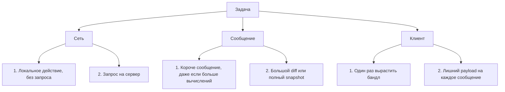

# Принципы решений

Приоритеты для любой задачи в Matreshka. Список будет дополняться.

Три шкалы независимы. Внутри шкалы верхний пункт важнее нижнего. Если шкалы тянут в разные стороны: сначала убрать round-trip, потом сжать сообщение. Бандл клиента при этом можно увеличить.

## Меньше запросов

Если эффект можно сделать на клиенте, это локальное действие, а не round-trip. Запрос на сервер — когда нужно его состояние, авторизация или данные, которых на клиенте нет.

## Локальные действия универсальны

Они живут в общем клиенте и не кодируют сценарий одного проекта. Проектная логика остаётся на BFF; клиент получает только общее действие.

## Короче сообщение важнее лишних вычислений

Считать на клиенте или на BFF дешевле, чем слать большой diff. Так уже устроен [context diff](../architecture/context-diff.md): выбирается более короткое представление. Дальше кадр должен стать ещё короче; в перспективе — protobuf.

## Бандл один раз, payload каждый раз

Допустимо один раз увеличить клиент, чтобы на проводе было меньше байт. Пример: padding можно задать одним числом или по сторонам. Компактная форма на проводе и разворачивание на клиенте лучше, чем всегда слать четыре поля.
