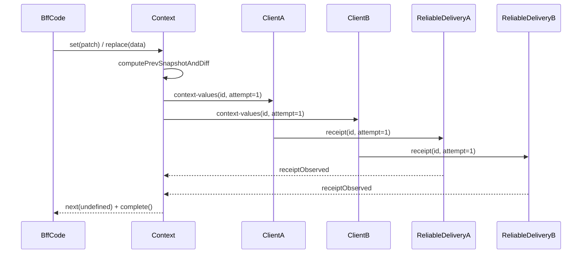
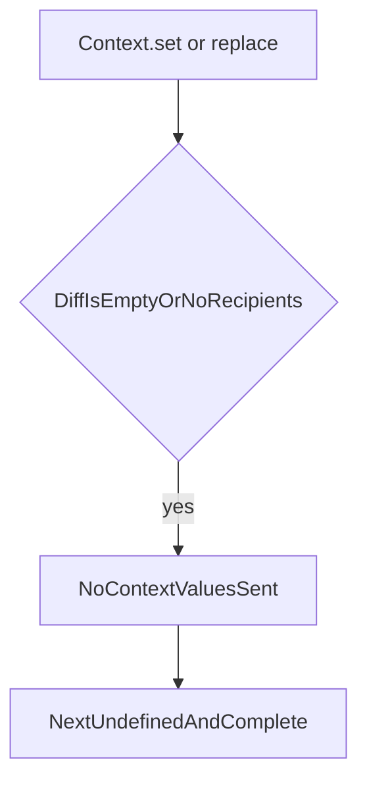

# Доставка server-updates Context

Документ описывает, что именно означает completion у `Context.set(...)`, `Context.replace(...)` и `ContextRef.set(...)` на BFF после перехода на hot `Observable<void>`.

Связанные документы:

- [context-lifecycle.md](context-lifecycle.md) — общий lifecycle `Context` на BFF и клиенте.
- [message-delivery.md](message-delivery.md) — reliable delivery, receipt, retry и дедупликация.
- [../guides/context.md](../guides/context.md) — практическое API `Context` / `ContextRef`.

## Коротко

- `context.set(...)`, `context.replace(...)` и `ref.set(...)` на BFF теперь возвращают **hot `Observable<void>`**.
- Работа стартует **в момент вызова метода**, а не при первой подписке.
- Completion означает: **все фактические адресаты diff** прислали transport-level receipt на свои `context-values`.
- Если `diff = {}` или адресатов нет, Observable сразу делает `next(undefined)` и `complete()`.

Это не application-level ack из `ContextHubService`: BFF знает, что сообщение дошло до клиентского runtime reliable-delivery слоя, но не ждёт отдельного подтверждения "diff применён в Angular service".

## Почему именно transport-level receipt

`context-values` уже является reliable targeted message. Значит, runtime и без нового протокола умеет:

1. помечать исходящее сообщение как pending;
2. повторять отправку при отсутствии receipt;
3. завершать retry-цикл, когда receipt пришёл;
4. дедуплицировать прикладную обработку дубликатов на клиенте.

Поэтому для server-side `Context` достаточно дождаться receipt каждого outgoing `context-values`, не добавляя отдельный client-to-BFF ack после применения diff в `ContextHubService`.

## Что считается адресатом

Wait-group строится только по тем клиентам, которым **реально** надо слать diff:

- в него входят все привязанные клиенты, которым положено получить `context-values`;
- из него исключается клиент-источник, если изменение пришло от него самого через client-to-BFF `context-values`;
- если после вычисления diff отправлять нечего, wait-group пустой.

## Нормальный поток

Ключевые свойства:

- сообщение уходит сразу при вызове метода;
- Observable можно подписать позже и всё равно получить replay terminal-success;
- если receipt потерялся, retry делает existing reliable-delivery слой, а completion наступит только после фактического receipt.

## Пустой diff или нет адресатов

Это считается успешным сценарием, потому что у BFF нет ни одного обязательного outgoing diff, доставку которого нужно ждать.

## Client-originated update

Если изменение пришло от клиента:

1. BFF валидирует payload;
2. применяет patch к `Context`;
3. строит diff относительно предыдущего snapshot;
4. рассылает diff только **другим** клиентам;
5. completion ждёт receipt только от этих других клиентов.

Так предотвращается эхо обратно в клиент-источник и не возникает двойной рассылки при server-side re-broadcast.

## Границы гарантии

Этот контракт гарантирует:

- hot API без fire-and-forget `void`;
- ожидание receipt всех фактических получателей;
- мгновенный success при отсутствии полезной отправки;
- reuse уже существующего retry/dedup механизма.

Этот контракт **не** гарантирует:

- отдельное подтверждение применения diff внутри `ContextHubService`;
- exactly-once delivery на transport уровне;
- сохранность pending-состояния после рестарта процесса.
