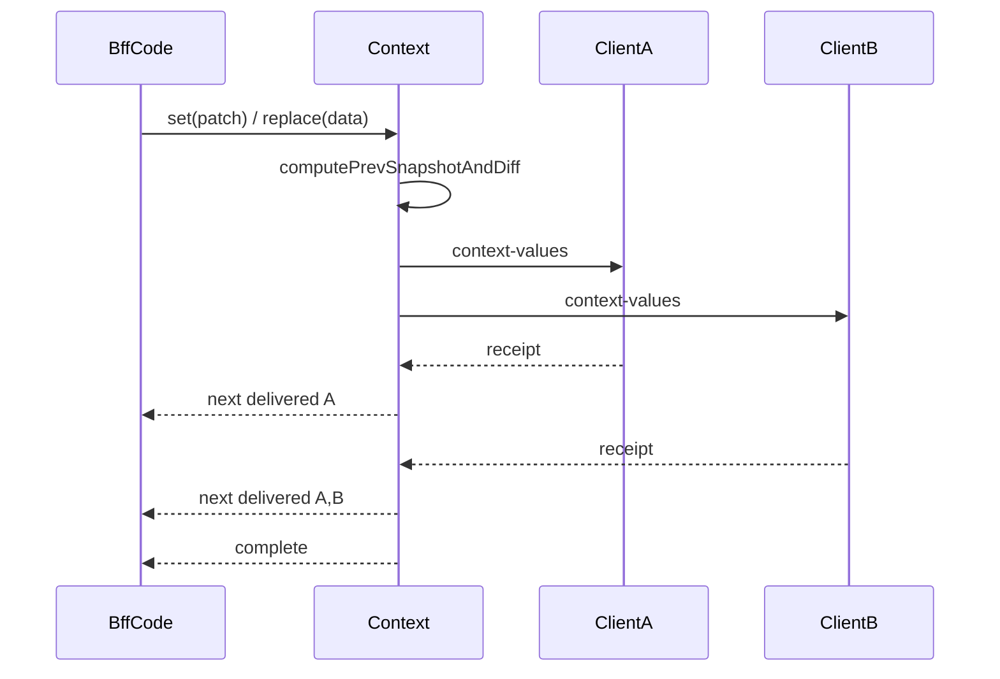
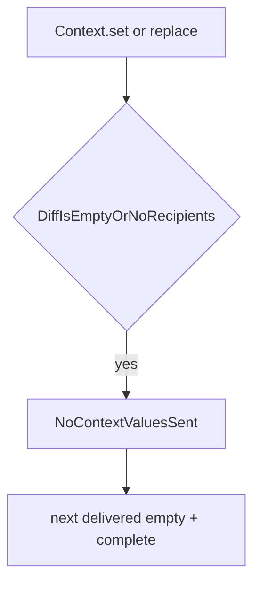

# Доставка server-updates Context

Документ описывает семантику `Context.set(...)`, `Context.replace(...)` и `ContextRef.set(...)` на BFF: hot `Observable<ContextUpdateDelivery>` и прогресс по клиентам.

Связанные документы:

- [context-lifecycle.md](context-lifecycle.md) — общий lifecycle `Context` на BFF и клиенте.
- [message-delivery.md](message-delivery.md) — reliable delivery, receipt, retry и дедупликация.
- [../guides/context.md](../guides/context.md) — практическое API `Context` / `ContextRef`.

## Коротко

- `context.set(...)`, `context.replace(...)` и `ref.set(...)` на BFF возвращают **hot `Observable<ContextUpdateDelivery>`**.
- Тип payload:

```ts
type ContextUpdateDelivery = {
  delivered: Client[]; // накопительный snapshot после каждого receipt
};
```

- Работа стартует **в момент вызова метода**, а не при первой подписке.
- После transport-level **receipt** каждого `context-values` у очередного адресата — **`next({ delivered })`**, где `delivered` растёт (порядок = порядок прихода receipt).
- **`complete()`** — когда receipt получены от **всех** ожидаемых адресатов diff.
- Если **`diff = {}`** или **нет получателей** — один **`next({ delivered: [] })`**, затем **`complete()`** (без исходящих `context-values`).

Это не application-level ack из `ContextHubService`: BFF знает, что сообщение дошло до клиентского runtime reliable-delivery слоя, но не ждёт отдельного подтверждения «diff применён в Angular service».

## Почему именно transport-level receipt

`context-values` уже является reliable targeted message. Значит, runtime и без нового протокола умеет:

1. помечать исходящее сообщение как pending;
2. повторять отправку при отсутствии receipt;
3. завершать retry-цикл, когда receipt пришёл;
4. дедуплицировать прикладную обработку дубликатов на клиенте.

Поэтому для server-side `Context` достаточно дождаться receipt каждого outgoing `context-values`, не добавляя отдельный client-to-BFF ack после применения diff в `ContextHubService`.

## Что считается адресатом

Список ожидаемых receipt строится только по тем клиентам, которым **реально** надо слать diff:

- в него входят все привязанные клиенты, которым положено получить `context-values`;
- из него исключается клиент-источник, если изменение пришло от него самого через client-to-BFF `context-values`;
- если после вычисления diff отправлять нечего, ожидаемых receipt нет.

## Нормальный поток



Ключевые свойства:

- сообщение уходит сразу при вызове метода;
- late subscriber получает replay всех прогресс-emission до `complete`;
- если receipt потерялся, retry делает existing reliable-delivery слой; следующий `next` наступит только после фактического receipt.

## Пустой diff или нет адресатов



Успешный сценарий: доставлять некому, в `delivered` передаётся пустой массив.

## Client-originated update

Если изменение пришло от клиента:

1. BFF валидирует payload;
2. применяет patch к `Context`;
3. строит diff относительно предыдущего snapshot;
4. рассылает diff только **другим** клиентам;
5. `next` / `complete` учитывают receipt только от этих других клиентов.

Так предотвращается эхо обратно в клиент-источник и не возникает двойной рассылки при server-side re-broadcast.

## Потребление Observable

- **`firstValueFrom(context.set(...))`** — только **первый** прогресс (может быть `{ delivered: [] }` или первый ack); не означает «все доставлено».
- **`lastValueFrom(...)`** — последний snapshot перед `complete` (полный список при успехе).
- Для пошагового UI или метрик — подписка на **`next`** и чтение накопительного `delivered`.
- Финал сценария — **`complete`** (все ожидаемые receipt) или **`error`**.

Если клиент уничтожен до receipt, `Client.waitForDelivery` может завершить ожидание как terminal без полного списка — тогда Observable может не дойти до `complete` со всеми адресатами.

## Границы гарантии

Этот контракт гарантирует:

- hot API с прогрессом по клиентам;
- `complete` только после receipt всех фактических получателей diff;
- `{ delivered: [] }` при отсутствии полезной отправки;
- reuse уже существующего retry/dedup механизма.

Этот контракт **не** гарантирует:

- отдельное подтверждение применения diff внутри `ContextHubService`;
- exactly-once delivery на transport уровне;
- сохранность pending-состояния после рестарта процесса.
