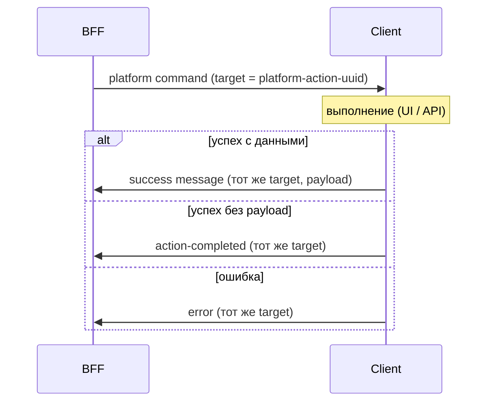

# Platform-action: философия request/response

Платформенные методы на BFF (геолокация, скачивание файла, WebAuthn, push и т.д.) — это не односторонние команды «отправил и забыл». Это **коррелированные действия**: BFF инициирует работу на клиенте и **обязательно** получает от клиента сигнал о том, как она завершилась.

Транспорт и формат — в [`protocol.md`](protocol.md) (`target`, `platform-action-<uuid>`). Публичные методы платформ — в [Platform API](../reference/platforms.md).

## Принцип

1. BFF отправляет **targeted** сообщение с уникальным `target` (correlation id).
2. Клиент выполняет действие (диалог, API браузера, нативный вызов).
3. Клиент **всегда** отвечает одним targeted-сообщением с **тем же** `target`:
   - **результат** — success-сообщение с payload (координаты, subscription Web Push, credential JSON и т.п.);
   - **успех без данных** — общее сообщение завершения без payload ([`ActionCompletedMessage`](../../shared/messages/client-to-bff/action-completed-message.ts), тип `action-completed`; то же для [component-action](component-actions.md));
   - **ошибка или отмена** — `ErrorMessage` с текстом для пользователя или лога.

Не допускается сценарий, в котором клиент молча выполнил действие, а BFF об этом не узнал. Иначе на сервере нельзя надёжно построить ни UX (loading, toast), ни бизнес-логику после шага (verify WebAuthn, сохранить файл в БД, перейти дальше по сценарию).

## Зачем это нужно

| Возможность | Как используется |
| ----------- | ---------------- |
| **Отслеживание процесса** | BFF (или код приложения на BFF) может подписаться на завершение action и показать ошибку, снять loading, записать метрику. |
| **Действия по окончанию** | После ack можно вызывать verify, обновлять Context, навигировать — только когда клиент подтвердил успех или вернул данные. |
| **Единый контракт** | Действия с данными и «простые» (скачать CSV, открыть файл) отличаются только типом успешного ответа, а не наличием ответа вообще. |

На BFF такие методы обычно возвращают `Observable`: запрос уходит при вызове метода; подписка нужна только если код сервера хочет **дождаться** результата или ошибки. Без подписки действие на клиенте всё равно стартует; без ответа клиента observable не завершится (кроме уничтожения клиента).

**Семантика «завершения»** зависит от действия: ack означает согласованную точку в сценарии на клиенте, а не всегда «пользователь всё сделал». Например, для скачивания файла в браузере успех обычно соответствует **старту** загрузки (запрос к ресурсу / save dialog), а не окончанию записи файла — OS и API это не сообщают. Таблица примеров — в разделе [Platform-action и Observable](../reference/platforms.md#platform-action-и-observable) справочника платформ.

**`Platform.reload()`** — исключение по способу ack: клиент не может отправить `ActionCompletedMessage` до перезагрузки. BFF отправляет `AppReloadMessage` и завершает observable при **`Client.reconnect$`** (повторное подключение transport с тем же token в grace period). Реализация: `bff/platforms/utils/client-reload-platform-action.ts`.

**`Platform.navigate()`** и **`Platform.back()`** — без targeted ack: `AppNavigateMessage` / `AppBackMessage` без `target`, клиент не шлёт `ActionCompletedMessage`. Завершение на BFF: смена `client.state.route`, receipt `AppPageMessage` (`client-navigate-platform-action.ts`, `client-back-platform-action.ts`; общее ожидание — `client-route-page-wait.ts`). У navigate дополнительно `{ routeMatched }`.

**Стримы (много ответов с одним target)** — например BLE scan: hot-сессия через `targetedClientPlatformStream` (`bff/platforms/utils/targeted-client-platform-stream.ts`): исходящее сообщение при вызове, каждый элемент через `parseItem`, stop через `onTeardown` при отписке всех observers.

## Схема

## Связь с другими частями системы

- **Component commands** — см. [component-actions.md](component-actions.md): `target` = instance id, ack по полю **`actionScope`** (`component-action-<uuid>`).
- **Context messages** используют свой `target` (context id) — та же идея адресации, другая область.
- **Reliable delivery** ([`message-delivery.md`](message-delivery.md)) относится к доставке по wire; platform-action дополнительно задаёт **семантику завершения** на уровне API платформы.

При добавлении нового platform-action сохраняйте этот контракт: targeted запрос, ровно один завершающий ответ с тем же `target`, регистрация типов в `shared`.
